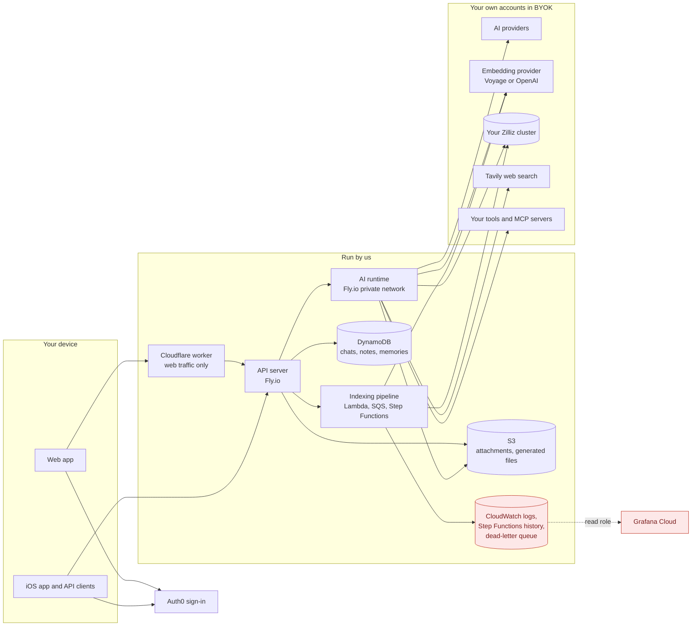

# Privacy Review and Recommendations

**Product:** Unbiase AI (web app at genflowly.com, iOS app, developer API)
**Reviewed:** 2026-11-05, `development` branch at `2b0739e9` plus the working tree
**Statuses updated:** 2026-11-06, checked read-only against production
**Companion document:** [Policy.md](Policy.md), the draft privacy policy

This is an engineering review, not legal advice. Have a lawyer review the policy before it is published.

---

## 1. Summary

The foundations are better than most apps at this stage. The app has no analytics, ad trackers or data sales, we don't train on user content, and no shared platform keys are used for customer traffic. Stored API keys are encrypted with KMS, and production logs were clearly designed to exclude user content.

However, five problems mean an accurate privacy policy today would read badly, and a flattering one would be false:

| #   | Problem                                                                                                                                                                                                                                                                            | Why it matters                                                                                                        | Fix size                                   | Status                                                                                                                                                                                                                    |
| --- | ---------------------------------------------------------------------------------------------------------------------------------------------------------------------------------------------------------------------------------------------------------------------------------- | --------------------------------------------------------------------------------------------------------------------- | ------------------------------------------ | ------------------------------------------------------------------------------------------------------------------------------------------------------------------------------------------------------------------------- |
| 1   | **Full chat and note text is stored in production logs and queues.** Step Functions records it for up to 90 days, CloudWatch for 7 days and the dead-letter queue for 14 days. The queue held 381 messages when checked.                                                           | Contradicts the repo's own "no content in production logs" rule. A role set up for Grafana Cloud can read these logs. | Hours for logging, days to remove it fully | **Live since 2026-11-05** (PRs #331 and #332). Execution history from earlier runs keeps text until it ages out, by 2027-02-04. The trigger lambda never got the fix (see R1).                                                                                           |
| 2   | **Public share links can expose private notes and memories.** Agent trace data goes to anonymous viewers with only one step type redacted.                                                                                                                                         | The most direct way a user could be harmed today.                                                                     | Under a day                                | Open                                                                                                                                                                                                                      |
| 3   | **Users can't delete things.** There is no delete for conversations or notes, no account deletion, no export, and no way to remove a stored API key. Archived chats can still be fed to AI providers.                                                                              | Required by Apple and by GDPR and CCPA. Most of the deletion code already exists on an unmerged branch.               | 1-2 weeks                                  | **Live since 2026-11-06** (PR #334): delete is permanent and everywhere for conversations, notes and accounts, and deleted content can't reach AI providers. Export is still open, and since PR #335 the apps can't delete old notes (Policy.md N1). |
| 4   | **Data reaches more vendors than the user chose.** Memory is on with no off switch. Saving a note sends it to an AI provider. A chat with Claude can have its title and memory work sent to OpenAI.                                                                                | This is the biggest gap against the goal of "maximum privacy" in BYOK.                                                | Days                                       | **Live since 2026-11-05** (PR #332): memory switches (on by default), and background tasks run only on the priority-1 provider. A chat on another vendor still sends its title and memory work to that provider.          |
| 5   | **Provider defaults are not disclosed.** Voyage, the embedding provider the setup wizard recommends, may train on content unless the user opts out, and opting out requires a payment method. OpenAI keeps Responses API state for 30 days because `store` is left at its default. | Users assume BYOK means their data is safe with vendors.                                                              | Days                                       | Open                                                                                                                                                                                                                      |

**Recommended order:** do the config-only fixes in Phase 0 this week, ship the Phase 1 product changes, then publish the policy. Section 8 has the sequence and section 9 lists the decisions I need from you.

### How to read the evidence

| Label | Meaning |
|---|---|
| **[code]** | Read in this repo. Paths and line numbers are included. |
| **[live]** | Confirmed on 2026-11-05 with read-only checks on AWS, GitHub, Fly and public HTTP endpoints. |
| **[vendor]** | Read on the vendor's own page on the same date. Sources are in section 10. |
| **[secondary]** | From third-party sources only. Verify before relying on it. |

**What I did and didn't touch.** The live checks read configuration, counts and system-owned agent settings. I did not read any customer conversations, notes, log contents or queue messages, and I changed nothing.

**Not reviewed:** Auth0 tenant settings, Cloudflare dashboard settings (log retention, for example), Zilliz and Supabase account settings, and the admin panel UI. This was not a penetration test.

### What is already good

The policy can rely on these today:

- **No trackers.** No analytics, advertising or session-replay SDKs in the web or iOS apps. `reportWebVitals()` is called with no handler, so it sends nothing (`genai-react-app/src/index.tsx:24`). [code] No analytics beacon appears on the live page. [live]
- **No shared infrastructure for customer traffic.** Customer requests never run on system keys (`GenerationAgentExecutor.kt:243-260`), and vector DB, embedding and search have no platform fallback (`vector_db.py:24-33`, `web_search.py:155-167`). [code]
- **Keys are handled carefully.** They are KMS-encrypted, never returned to clients, and never cached in the browser (`storageKeys.ts:8-11`). [code]
- **Production logging is restrained.** Production logs at WARN and above, with a content gate and masked Auth0 IDs. Metrics carry no per-customer labels. [code]
- **Storage is private.** The attachments bucket blocks public access, and presigned URLs are short-lived: 15 minutes for upload, 1 hour for viewing (`S3Provider.kt:29,47`). [code]
- **Sharing defaults are sensible.** Discoverability is off by default, and archiving a conversation revokes its shares (`ConversationManagementService.kt:168`). [code]
- **Logout clears the device.** Web and iOS both wipe local data (`AuthContext.tsx:123`, `CacheStore.swift:115-138`). [code]

---

## 2. How data moves today

### 2.1 System map

Web traffic goes through Cloudflare, which decrypts TLS at its edge and re-encrypts to Fly. iOS and developer API traffic goes straight to Fly, because `api.genflowly.com` resolves to Fly rather than Cloudflare. [live] The README still describes this host as proxied through Cloudflare, so that section is out of date.

### 2.2 One chat turn

| # | What happens | Data | Where it goes | Evidence |
|---|---|---|---|---|
| 1 | You send a message | Prompt, attachment references | Cloudflare (web only), then the API server | `worker.js:107-114` |
| 2 | Saved before any AI call | Prompt, system prompt copy, attachment references | DynamoDB `Message` | `GenerationOrchestrator.kt:471-490` |
| 3 | New web chat: title job starts alongside the reply | First message and instruction name | The background-task provider, see section 2.5 | `GenerationOrchestrator.kt:428-434` |
| 4 | Your key is decrypted | Vendor API key, in memory | KMS to API server to AI runtime, in the request body | `GenerationOrchestrator.kt:510-513` |
| 5 | Memory lookup, on by default | If you have stored memories, your message is embedded and the vector searches Zilliz. Matching and core memories join the system prompt. | Embedding provider, your Zilliz | `memory.py:226-238`, `llm_node.py:846-848` |
| 6 | AI call | Full thread history, system prompt with memories, attachments as base64 | Every provider selected for this turn | `llm_factory.py`, `pdf_input.py:83-89` |
| 7 | Tools, when the model calls them | Search query, tool arguments, knowledge search results | Tavily, embedding provider and Zilliz, your connected endpoints. Scratch files and PDFs go to S3. | `web_search.py:24`, `knowledge_tool.py:136`, `tool_executor.py:39` |
| 8 | Reply saved | Reply text, reasoning and tool trace ("thinking steps"), sources, tokens, cost | DynamoDB `Message` | `GenerationOrchestrator.kt:694-733` |
| 9 | Memory extraction, on by default | Last 12 messages (up to 2,000 characters each) and all your stored memories | Background-task provider. New memories go to DynamoDB, the embedding provider and Zilliz. | `MemoryExtractionService.kt:280-287,501-515,569-570` |
| 10 | Indexing, always attempted | `User: ... Assistant: ...`, up to 30,000 characters per side | API Gateway, Lambda, SQS, Step Functions, embedding provider, Zilliz. Plain text is stored in Zilliz and copied to logs and the queue. After PR #331, SQS and Step Functions hold IDs only. | `ExchangeSideEffects.kt:32`, `ConversationIndexingService.kt:55-88`, `conversation_processor.py:86` |

### 2.3 One note

| # | What happens | Data | Where it goes | Evidence |
|---|---|---|---|---|
| 1 | Autosave while typing | Note text and title | DynamoDB `CustomerNotes`. Full body also cached in browser `localStorage`. | `NotesService.kt:84-96`, `notesCache.ts`, `saveNotesService.ts:25-31` |
| 2 | Editing ends: memory extraction, on by default | Up to 8,000 characters and all stored memories | Background-task provider | `NotesService.kt:100`, `MemoryExtractionService.kt:367-370` |
| 3 | Title, if untitled and at least 15 characters | First 4,000 characters | Background-task provider | `NotesService.kt:37-50,108-110` |
| 4a | Indexing, realtime mode (the default) | Full text | API Gateway, Lambda, SQS, Step Functions, embedding provider, Zilliz. After PR #331, SQS and Step Functions hold IDs only. | `NotesService.kt:143-163`, `note_processor.py:80` |
| 4b | Indexing, batch mode | Full text and chunks | Versioned S3 document kept indefinitely, plus a file uploaded to Voyage | `accumulate_voyage_notes_lambda.py:149,241`, `poll_voyage_batches_lambda.py:227` |
| 5 | Later chats | Matching chunks | Whichever AI provider serves that chat, when the agent uses `search_knowledge_base` | `knowledge_tool.py:136,191` |

### 2.4 What would surprise a user

- **Saving a private note sends it to an AI provider**, up to twice, even if the user never asks the AI about it.
- **Choosing Claude doesn't mean only Anthropic sees the chat.** Titles and memory extraction prefer OpenAI when an OpenAI key exists, and can fail over to any other stored key.
- **With memory on and memories stored, every message also goes to the embedding provider,** so that related memories can be looked up.
- **Switching provider mid-conversation sends the whole history to the new provider,** including images.
- **Text enters the indexing pipeline even if the user connected no embedding key or vector database.** It then fails and sits in the dead-letter queue (R6).
- **Archiving a chat doesn't stop it being used.** Its text can still be retrieved and sent to an AI provider in later chats (R3).

### 2.5 Background AI tasks

These run on the user's keys without an explicit request:

| Task | Trigger | What is sent |
|---|---|---|
| Conversation title | First message of a new web chat | First message, instruction name |
| Note title | Editing ends, note untitled, at least 15 characters | First 4,000 characters |
| Memory from chat | After exchanges, debounced | Last 12 messages (up to 2,000 characters each), all stored memories |
| Memory from note | Editing ends, at least 30 characters | Up to 8,000 characters, all stored memories |
| Instruction icon and category | At login, when missing | Instruction text (`InstructionService.kt:484-494`) |
| Key validation | When a key is saved | One small authenticated request |
| Embedding model discovery | When a key is saved, then weekly | The single-character string `"a"` (`probe_models.py:39`, `EmbeddingModelCatalogService.kt:281`) |

**How the provider is chosen** (`GenerationAgentExecutor.kt:213-233`):

1. The user's own priority list from Settings, if they set one.
2. Otherwise the agent's preferred vendor, if the user has a key for it. The bundled defaults prefer OpenAI (`request-agent-defaults.json:12,20,28`).
3. Then every other vendor with a stored key, tried in turn until one succeeds.

**After the R9 fix** (live since 2026-11-05): one provider only. That is the priority-1 key, or the first key added when none has a priority, on that vendor's small model (`gpt-5-mini`, `claude-haiku-4-5`, `gemini-2.5-flash`). There is no failover to other keys.

---

## 3. Third parties

### 3.1 Services we operate

| Service | Used for | Sees user content? | Status |
|---|---|---|---|
| **AWS** (us-east-1) | DynamoDB, S3, KMS, SQS, Step Functions, Lambda, API Gateway, CloudWatch | **Yes**, at rest and in the pipeline | Live |
| **Fly.io** (iad) | API server and AI runtime | **Yes**, in memory, including decrypted keys. Normalized images are cached on local disk (up to 512 MiB). | Live |
| **Cloudflare** | DNS, static site hosting, router worker. Adds a bot-detection script to pages. | **Yes**, in transit, for web traffic | Live |
| **Auth0 (Okta)** | Sign-in | No content. Name, email, picture, login metadata. | Live |
| **Grafana Cloud** | Dashboards and alerts | Metrics carry no content, **but** its CloudWatch role can read logs. Workflow logs held content until the R1 fix went live on 2026-11-05, and streams written before then expire by 2026-11-12 | Live: role `GrafanaCloudWatchReadOnly` with `CloudWatchReadOnlyAccess` exists in both accounts |
| **Supabase** | Durable agent runs (Postgres) | **Would hold** prompts, history and tool results | `DATABASE_URL` is set only in the development GitHub environment. **Production needs your confirmation** (Q7). |
| **Sentry** | iOS crash reporting | Not active | Package linked, DSN blank in every stage |
| **Grafana Loki** | Log shipping | Not active | Scaffolded in `observability/log-shipper/`, not deployed [live] |

### 3.2 Services the user connects in BYOK

| Service | Receives | Notes |
|---|---|---|
| **AI providers** | Prompts, history, instructions, memories, retrieved notes, attachments, tool results | The production vendor allowlist is unset, so **every vendor in the catalog is allowed**. [live] That includes OpenAI, Anthropic, Google, xAI, Mistral, Groq, DeepSeek, Cohere, Perplexity, Together, Fireworks, NVIDIA and the LiteLLM long tail. |
| **Voyage AI or OpenAI** (embeddings) | Chat exchanges, notes, memories, instructions, search queries, and chat messages when memory is on | Voyage is the provider the setup wizard recommends |
| **Zilliz Cloud** | **Plain-text** chunks, vectors, titles, customer ID | The user's own cluster. Credentials are KMS-encrypted. |
| **Tavily** | Search queries the model writes, which can reflect the conversation | Only if a Tavily key is stored |
| **User-defined tools, MCP servers, OpenAPI connectors** | Tool arguments the model writes | Destinations are pinned and tools are never enabled implicitly |
| **Hugging Face** | No user content. Tokenizer downloads only. | Optional token |

### 3.3 Searched for and not found

Stripe or any other payment provider, email or SMS services, analytics, session replay, and advertising SDKs.

`langsmith` and `opentelemetry-api` are present as transitive dependencies, but nothing in the repo or CI enables them. [code] I can't see every Fly secret from here, so R19 recommends disabling tracing explicitly.

### 3.4 What providers do with the data

Checked 2026-11-05. These terms change, so re-check before using them in the product.

| Provider | Trains on API data by default? | Retention | What to do | Confidence |
|---|---|---|---|---|
| **OpenAI API** | No, unless you opt in | Abuse logs up to 30 days. Responses API state 30 days by default. Zero retention requires OpenAI's approval. | Send `store=false` (R10) | [vendor] |
| **Anthropic API** | No by default. Feedback you submit is an exception. | Deleted within 30 days. Up to 2 years if flagged for usage-policy violations. "Covered Models" have required retention. | Disclose | [vendor] |
| **Google Gemini API** | **Free tier: yes, with possible human review.** Paid tier: no. Paid-tier terms apply to all use in the EEA, Switzerland and UK. | Paid: logged for a "limited period" | Warn about free-tier keys | [vendor] |
| **Voyage AI** | **Yes, unless you opt out.** The terms grant a "worldwide, irrevocable, perpetual" licence including the right to train. | After opt-out, deleted once processed. The opt-out needs a payment method and an org admin, and isn't retroactive. Batch files are kept 30 days. | Warn before the key is saved (R11) | [vendor] |
| **Tavily** | A setting, "Allow use of query data", controls this. Its default isn't stated. | Off means queries are not stored. Tavily's FAQ also claims zero data retention. | Tell users to turn it off | [vendor] |
| **DeepSeek** | Policy lists training as a purpose, with an opt-out right | Stores personal data in the People's Republic of China. End users of apps built on its API are outside this policy, and the developer is the controller. | Warn in BYOK. Exclude from Paid mode. | [vendor] |
| **Mistral** | Its help page says API logs aren't used for training | 30 days | Verify. Secondary sources mention exceptions for some models. | [vendor], [secondary] |
| **xAI, Groq, Cohere, Perplexity, Together, Fireworks, NVIDIA** | Not verified. xAI's and Groq's pages refused automated access, and I didn't review the others. | | Review before showing any in-app label | None |

---

## 4. Where data stays

The "today" columns show production on 2026-11-05, before the fixes. "Target" assumes the recommendations below are done, and **Live** marks the targets that have reached production since. Account deletion, live since 2026-11-06 (R4), deletes every store here that we control, except Step Functions history, logs, Voyage files, Supabase and backups.

| Store | Holds | Retention today | Deletion path today | Target |
|---|---|---|---|---|
| DynamoDB `Message`, `Conversation` | Prompts, replies, system prompt copies, tool results, thinking steps, cost | **Forever** | **None.** Archive only sets `archivedAt`. | Permanent delete, everywhere. **Live since 2026-11-06** (no Trash: you chose immediate deletion). Optional auto-delete still open. |
| DynamoDB `CustomerNotes` | Note text | **Forever** | **None.** Archive sets `is_delete`, and re-saving the same key restores the note. | Permanent delete. **Live since 2026-11-06**, but the apps lost their notes page in PR #335 (Policy.md N1) |
| DynamoDB `CustomerMemory` | Learned facts | Until deleted | Hard delete per fact. Vector delete is best-effort. | Add "delete all". **Live since 2026-11-05** (Settings > Defaults > Learned facts) |
| DynamoDB `CustomerProfile` | Auth0 ID, email, name, picture, username | **Forever** | **None** | Deleted with account (**live since 2026-11-06**). Store less (R27). |
| DynamoDB key tables | Encrypted AI, embedding, search, vector DB and tool credentials | Until replaced | **Tool keys only.** No delete for AI keys, Voyage keys or vector DB credentials. | Delete any of them, any time. All at once: **live since 2026-11-06**. One at a time: open. |
| S3 attachments bucket | Uploads, generated PDFs, agent scratch files | **Forever.** No lifecycle rules. [live] | **None** | Deleted with the conversation; scratch expires after 1 day. **Both live since 2026-11-06** |
| S3 `customer-documents` | Batch-mode note documents | **Forever, versioned.** [live] | **None** | Deleted with the note, including all versions. **Live since 2026-11-06** |
| Step Functions history | **Full chat and note text** | **90 days** after each run | None | IDs only. **Live since 2026-11-05.** Runs from before it keep their text until they age out, by 2027-02-04. |
| CloudWatch Step Functions logs | **Full chat and note text** | **7 days** [live] | None | Errors only, no execution data. **Live since 2026-11-05.** |
| SQS dead-letter queue | **Full chat and note text** | **14 days**. 381 messages in production. [live] | None | IDs only, 7 days. **Live since 2026-11-05.** |
| SQS ingestion queue | Full text | Seconds normally, 4 days at most [live] | None | IDs only. **Live since 2026-11-05**, except email (R25). |
| Lambda logs | WARN and above: IDs and error text | **Never expire** [live] | None | 30 days |
| Your Zilliz cluster | Plain-text chunks and vectors | Until deleted | Notes and memories best-effort. **Conversations never.** | Deleted with the source item. **Live since 2026-11-06** for conversations and notes, and search hides anything left behind |
| Voyage file storage | Batch input and output | About 30 days [vendor]. We don't delete them. | None | Deleted when the job completes |
| AI, embedding and search providers | What was sent | Their terms | Not ours to delete | Disclosed |
| Supabase (development) | Prompts, history, tool results | **No expiry** except `run_events`, 7 days (`durable_runtime.py:30`) | None | Time limit before any production use |
| Browser `localStorage` | Auth0 tokens, full note bodies, conversation titles, instructions, drafts | Until logout | Logout | Tokens in memory, note metadata only |
| iOS on-device store | History, notes, instructions, drafts. Tokens in Keychain. | Until logout | Logout | Stronger file protection |
| DynamoDB backups | Copies of table data | 35 days on newer tables. **Off on `Message`, `Conversation`, `CustomerProfile` and the credential tables.** [live] | Expire | 35 days everywhere, consistently |

No DynamoDB table in production has TTL enabled, so nothing expires automatically. [live]

---

## 5. P0: fix before publishing the policy

Effort: **S** is under a day, **M** is a few days, **L** is a week or more.

### R1. Full chat and note text was stored in production logs and queues (fix live 2026-11-05)

**What happens.** Indexed chats and notes travel as full text through SQS. The trigger passes that text as the Step Functions input (`trigger_lambda.py:65`), and the chunking step returns chunks in the workflow state (`parse_and_chunk_lambda.py:85`). The state machine logs at `ALL` with `includeExecutionData: true` (`stepfunctions-v2-stack.ts:116-117`). Production has this exact setting. [live]

This directly contradicts `genai-proxy-server/development.md`, which says production never logs user content. The gate there covers application log lines, not AWS's own workflow logging.

**Where copies end up:**

| Copy | Lifetime | Source | After PR #331 |
|---|---|---|---|
| CloudWatch log group | 7 days | `stepfunctions-v2-stack.ts:105` [live] | Production logs errors only, without execution data |
| Step Functions execution history | 90 days, or 30 through an AWS support case | [vendor]. Standard workflows keep this regardless of CloudWatch logging. | IDs only. Runs from before the deploy keep their text until they age out. |
| Dead-letter queue | 14 days. Failed runs send the original message there. | `stepfunctions-v2-stack.ts:75-79`, `sqs-stack.ts:23` | IDs only, kept 7 days |

The production DLQ held **381 messages** when checked. I read the count only. Each entry is a full original payload by design.

**Third-party exposure.** The `GrafanaCloudWatchReadOnly` role exists in production with `CloudWatchReadOnlyAccess`, which includes reading logs. [live] The README itself warns that CloudWatch logs contain customer data (`README.MD:198`).

**Fix:**

1. **Today:** set `level: ERROR` and `includeExecutionData: false`, then delete the existing log streams.
2. **Today:** narrow the Grafana role to metrics plus specific non-content Lambda log groups.
3. **This phase:** send IDs instead of text. Messages carry only `customerId`, data type, entity key, model and `request_id`. Lambdas read the text from DynamoDB when they run, and chunking happens inside the embedding step so that chunks never enter workflow state. This removes content from SQS, Step Functions and the DLQ together.
4. **Meanwhile:** open an AWS support case to cut execution history retention to 30 days. Old history keeps holding text until it ages out.

**Effort:** S for steps 1, 2 and 4. M for step 3.

**Status (2026-11-06): steps 1 and 3 have been live in production since 2026-11-05.** PR #331's code reached production with PR #332's merge (9f27e810), whose encoding deploy succeeded. Checked read-only on 2026-11-06:

- **Logging.** Production state-machine logging is `ERROR` with `includeExecutionData: false`. Dev keeps `ALL`.
- **Ids instead of text.** Notes, conversations, instructions and memories travel as ids in every stage. Ingest strips the text before the queue, and `parse_and_chunk` returns chunk plans. Both pipeline lambdas reload the text from DynamoDB through `encoding-server/services/content_source.py`, which checks that the record belongs to the message's customer. The ingest-notes, parse-and-chunk and create-and-store lambdas run the image built from `73f648e`.
- **Dead-letter queue.** Retention is 7 days in both stages, so messages queued before the fix expire by 2026-11-12. It held 429 messages.
- **Not live: the trigger's safety net.**
  - The trigger is meant to strip text from messages queued in the old format. In both stages it still runs the image it resolved on 2026-10-10.
  - Its CDK named the mutable `parse-and-chunk-latest` tag, which never changes the template, so CloudFormation never updated the function.
  - New note, chat, instruction and memory messages carry no text, so this matters only for old messages. Until the fix deploys, don't redrive the dead-letter queue: the old trigger would copy any text in it into new execution history for another 90 days.
  - Fixed in `e258f3a3`: `stepfunctions-v2-stack.ts` now takes the commit's tag, like the other lambdas. Live in dev since 2026-11-07 (the dev trigger runs `parse-and-chunk-7b7c939`). Merged to `main` in PR #337 on 2026-11-07; the production deploy was still running when checked.
- **Still open:**
  - Step 2: the Grafana role still has `CloudWatchReadOnlyAccess`.
  - Step 4: the support case for 30-day history (7 days can't be configured).
  - Deleting the existing log streams. Those written before the fix expire by 2026-11-12 anyway.
  - Old execution history: it still holds text until it ages out, by 2027-02-04.
  - Email ingestion: it has no source table, so it still carries its text (see R25).

### R2. Public share links can expose private notes, memories and identity

**What happens.** `GET /api/v1/chat` works without login for publicly shared conversations (`GetConversationActivity.kt:25,65`). The response includes thinking steps, but only steps with `kind == "MEMORY"` are redacted for other viewers (`MemoryRedaction.kt:25,51`, `ConversationService.kt:160`).

**What anonymous viewers can therefore read:**

- **Note and past-chat text.** Tool steps keep the first 600 characters of each tool's output (`tool_executor.py:172,231,520`). `search_knowledge_base`, which returns note and past-conversation text, is enabled on the production default agent. [live]
- **Memory text** whenever `search_memories` is enabled on an agent. Its results arrive as a tool step, which bypasses the memory redaction.
- **Scratch file contents** returned by `fs_read`, also through tool steps. This tool is enabled on the default agent too. [live]
- **Search queries and tool arguments,** which often reveal what the user cares about (`tool_executor.py:482-490`, `streaming.py:227-242`).
- **Excerpts from pipeline nodes,** up to 1,500 characters of prompt and response (`llm_node.py:713-718`).
- **Identity:** the author's real name, picture and customer ID (`ConversationService.kt:185,253-262`), attachment S3 keys, and token and cost figures.

Attachment bytes are safe, because the URL endpoint only serves the caller's own files (`AttachmentService.kt:67-71`).

Search engines aren't told to stay away either. `robots.txt` allows all pages, and the worker writes the real title into shared pages. [live]

**Fix:**

1. **Switch from a deny-list to an allow-list.** Non-author viewers get only `node`, `name`, `kind` and `status` on every step, including the live reattach relay. This is applied at read time, so it also protects existing conversations immediately.
2. Remove customer ID, cost, tokens and S3 keys from non-owner responses.
3. Hide the author's name and picture from public viewers unless the owner opts in.
4. Add `X-Robots-Tag: noindex` for `/chat/*` in the router worker.
5. Say what becomes visible in the share dialog (`ShareModal.tsx`).
6. Consider removing the **Edit** option for public links (`ShareModal.tsx:172-173`). Today it lets any signed-in stranger with the link add to the conversation, and continuing it sends the history to that person's AI provider.

**Effort:** S.

### R3. There was no way to delete a conversation or a note (fix live 2026-11-06, except old notes)

**What happens.** The UI offers only "Archive conversation" and "Archive note" (`translation.json:259,982`), so the wording is honest. But no delete exists underneath it, and there is no restore UI either.

- **Conversations:** `DELETE /conversation/{id}` only sets `archivedAt` (`ConversationManagementService.kt:160-169`). No code path deletes `Message` or `Conversation` rows.
- **Notes:** soft-deleted, and re-saving the same key restores them (`NotesRepository.kt:63,176`).
- **Files:** attachments, generated PDFs and agent scratch files stay forever. The bucket has no lifecycle rules (`s3-stack.ts:23`) [live], even though `fs_tools.py:17` says a lifecycle policy handles expiry.
- **Batch-mode notes:** kept deliberately in a versioned bucket (`poll_voyage_batches_lambda.py:227`, `encoding-server-cdk/lib/s3-stack.ts:40`).

**Archived chats still reach AI providers.** Vectors are kept on purpose so that unarchiving restores search (`UnifiedSearchService.kt:59`). The search UI hides archived chats, but the agent tool has no such check (`retrieval.py:47,126-135`, `knowledge_tool.py:136`). So archived content can be retrieved and sent to an AI provider in a later chat, using the production default agent. [live]

**Most of the work already exists.** The branch `origin/claude/retrieval-server-runtime-tools-3rorik` has `ConversationPurgeService`, `PurgeJobWorker`, `CustomerDocumentsPurger`, S3 lifecycle rules, retention docs and tests. The `PurgeJobs` table is already deployed. Three caveats:

- The branch is 108 commits ahead of `development` and 289 behind, so this is a port rather than a merge.
- Its purge only runs for conversations of deleted customers. Its docs say "Archive and unarchive purge nothing."
- It needs the vector fix in step 4 below.

**Fix:**

1. **First, independently of everything else:** stop archived and deleted content reaching the model. Join hits back to DynamoDB before returning them, as `search_memories` already does. This is small and closes the worst part.
2. Add a real **Delete** action that moves items to Trash for 30 days and then purges them, with "Delete now" and a restore option.
3. Port the purge worker and the S3 lifecycle rules.
4. **Fix the vector purge.** `purge_vectors_lambda.py:145,160` looks for `{customerId}_*` collections, but data now lives in shared collections (`vector_db.py:171`). It would find nothing and report success. It must delete by `customer_id` filter instead. `PURGE_ALLOWED_CLIENT_IDS` is also empty in both stages, so every call is refused today. [live]
5. Delete notes fully: the row, all S3 versions and the vectors.

**Effort:** S for step 1. M to L for the rest.

**Status (2026-11-06): live in production since 2026-11-06 (PR #334), with the decision you made: archive is now delete, permanent and immediate, with no Trash.**

- **Steps 1 and 2.** "Archive" is renamed "Delete" for conversations and notes, behind a confirmation dialog. The owner's delete removes the conversation everywhere:
  - its row and every share (public link included);
  - its messages and the files they reference;
  - its vector-DB queue, memory-extraction and instruction-usage rows;
  - its vectors.

  A note loses its row, its batch-mode document (every version) and its vectors. Someone a conversation was shared with only removes their own access.
- **Archived content no longer reaches AI providers.** The agent's knowledge search checks each conversation and note hit against DynamoDB and drops anything deleted, archived or soft-deleted (`retrieval-server/graph/visibility.py`), so even vectors a failed delete left behind can't reach a prompt.
- **Step 3.** Deletes run as resumable jobs in `PurgeJobs` (no port of the old branch), with a final sweep 15 minutes later for replies that were still generating. Writes that could recreate a deleted row are now conditional. Agent scratch files are tagged and expire after a day.
- **Step 4.** Vectors are deleted by `customer_id` and item key across the shared collections (`/delete-conversation-vectors`, plus `/delete-customer-vectors` for accounts).
- **Step 5.** Notes are hard-deleted, including every S3 version of their document.
- **Still open:**
  - Learned facts from a deleted item stay (they are managed in Settings, and other conversations may have taught them too).
  - Files a fork made by someone else still references are deleted with the owner's conversation.
  - The iOS app: Delete with a confirmation is built (BUG-057) but not released.
  - Old notes: PR #335 (live 2026-11-06) removed the notes page, so the apps can no longer delete notes, yet knowledge search still returns them (Policy.md N1).
  - Items archived before this change: production's were deleted on 2026-11-06 with `scratch/purge_archived_items.py` (27 conversations with their 277 messages, and 3 notes; checked against a snapshot, nothing else was removed). Dev's are still stored.
  - Deletion jobs could not mark themselves done: `complete()` named the reserved word `sub` without an alias, so every finished job retried its final sweep (harmless, but an account job kept the login and username on its row). Fixed in `PurgeJobRepository`, not yet deployed.

### R4. There is no account deletion or data export (deletion live 2026-11-06, export open)

**What happens.** Neither exists on `development`. [code]

- **Apple** requires it: "If your app supports account creation, you must also offer account deletion within the app" (5.1.1(v)). [vendor]
- **GDPR and CCPA** give users deletion and portability rights.

**Existing work.** The same branch has `AccountDeletionService`, but three things must change:

- **It's admin-only.** Its docs say "There is no self-service route." It needs an authenticated self-service route and UI on web and iOS.
- **It keeps any conversation with a share, "PUBLIC included".** A public link would outlive the account. Public links should always be revoked and those conversations purged. Direct shares are your call (Q3).
- **Its vector step uses the old collection names,** the same bug as R3.

It also needs Auth0 Management API credentials, or the Auth0 user survives deletion.

**Fix:**

1. Port and adapt deletion as above, with a confirmation step and a status view.
2. Tell users that if their vector DB credentials are already invalid we can't reach their cluster, so they must delete that data themselves.
3. Add export: a downloadable archive of profile, conversations, notes, memories, instructions, agents and attachments, through a short-lived link.

**Effort:** M for the deletion port, M for export.

**Status (2026-11-06): deletion is live in production since 2026-11-06 (PR #334). Export is not built.** Settings > Profile > "Delete account" asks for "DELETE" to be typed, then calls `DELETE /api/v1/account`.

- **Rewritten, not ported.** The old branch is gone from GitHub; its code survived only in unreachable local commits and served as a checklist. It follows Q3's recommendation, which is still your call: everything goes, shared conversations included, so public links are revoked and recipients lose access. Messages the user wrote in other people's conversations stay there.
- **How it runs.** The profile, username and developer API keys are deleted before the request returns, so the login can't reach the account again. A job in the existing `PurgeJobs` table then deletes the rest in stages (content, then vectors, then credentials, then files, then the Auth0 user) and sweeps once more after 15 minutes for replies that were still generating. A restart or failure resumes it with backoff.
- **Vectors.** A new retrieval-server endpoint, `/delete-customer-vectors`, deletes by `customer_id` across the shared collections and drops the user's legacy collections. That fixes step 4 of R3 for account deletion. If the user's cluster can't be reached after six attempts, deletion finishes without it and records a warning; the dialog tells the user to clear it themselves.
- **Still open:**
  - **Auth0 login.** It is deleted only once Management API credentials are configured: create a machine-to-machine Auth0 application granted `delete:users`, then add `AUTH0_MGMT_DOMAIN`, `AUTH0_MGMT_CLIENT_ID` and `AUTH0_MGMT_CLIENT_SECRET` as secrets in both GitHub environments. Until then the login survives, and signing in again starts a new, empty account. On 2026-11-06 the secrets were still missing in both environments.
  - **iOS.** Apple requires deletion in the app itself. The button is built (BUG-058) but not released.
  - **Not covered:** export; durable-run data in Supabase (dev only, Q7); Voyage batch files; provider-side copies; DynamoDB backups, which expire after 35 days.

### R5. Users can't remove a stored API key (delete-all live 2026-11-06)

**What happens.** No route deletes an AI vendor key or vector DB credentials (`StoreCustomerVendorApiKeyActivity.kt:24,65` and `StoreCustomerVectorDBConfigActivity.kt:26` are POST only). The embedding key delete refuses everything except the Hugging Face token (`CustomerCredentialsService.kt:369`). Only tool credentials can be removed.

A user can only overwrite a key with another valid one, or revoke it at the vendor. For a BYOK product this is a basic gap, and the policy can't promise control over keys without it.

**Fix:** add DELETE routes and UI for all of them, and handle dependent settings. When a key is removed, skip that vendor in background tasks.

**Effort:** S.

**Status (2026-11-06): "Delete all API keys" is live in production since 2026-11-06 (PR #334).** Settings > Profile removes every stored credential in one step (`DELETE /api/v1/credentials`): AI and embedding keys, the vector DB connection, and tool and connector credentials. Tools keep their non-secret settings. Removing a single key is still not possible.

### R6. Text enters the pipeline even when it has nowhere to go (fix built 2026-11-06, not deployed)

**What happens.** `ConversationIndexingService.kt:55-88` and `NotesService.kt:143-163` never check whether the user has an embedding key or a vector database. For a chat-only BYOK user, text still goes through SQS, Step Functions and CloudWatch. The embedding step then raises an error (`create_and_store_lambda.py:68,78,228`), and the original message lands in the DLQ for 14 days.

This is the likely source of some of the 381 production messages, though I didn't read them to confirm it. The alarm has no recipient either, because `ADMIN_EMAILS` isn't set in the production GitHub environment. [live]

**Fix:** check both before sending and skip quietly if either is missing. In the Lambda, treat these two errors as a clean no-op rather than a failure.

**Effort:** S.

**Status (2026-11-06): built, not yet deployed.** Each profile now carries three entitlement flags, kept in step with the customer's credentials: `isVectorDbStoringEnabled` (a vector DB is connected), `isEmbeddingCreationEnabled` (a stored embedding key can embed) and `isWebSearchEnabled` (a web search key is stored). Saving or removing any key or connection re-derives them, and a profile from before the flags gets them on its first read.

- **Nothing is sent without both storage flags.** Chats, notes, instructions and memories skip the pipeline, and their retries stop. Search answers "not set up" without calling the retrieval server.
- **Tools fail fast.** Knowledge and memory search are never offered to the model without both storage flags, nor web search without its key. Memory recall falls back to core memories.
- **The pipeline checks too.** The store step and the retrieval server's encode endpoints look up the vector DB before embedding anything. A missing vector DB or key ends the message instead of failing it into the dead-letter queue (`vector_store_skipped_total`).
- **Still open:**
  - A flag read that fails lets the text through, so a DynamoDB error never drops indexing. The pipeline then skips it.
  - Email ingestion isn't gated by the flags (see R25).

### R7. Memory is on by default with no off switch (switches live 2026-11-05)

**What happens:**

- On unless `memoryEnabled` is `"false"`, and a failed read counts as on (`MemoryService.kt:34-39`).
- Each request defaults to learning and using memories (`GenerateTextStreamRequest.kt:32,34`).
- **No UI sets it.** `memoryEnabled`, `learnFromConversation` and `useLearnedPreferences` appear nowhere in the web, iOS or component-library source. [code]
- It learns from notes too (`NotesService.kt:100`).

Memory is the most sensitive feature in the app: it builds a profile of the user and injects it into prompts, so every provider used sees it.

**Fix:**

1. In BYOK, default **off** and offer it as a clear opt-in.
2. Provide three switches: learn from chats, learn from notes, use memories in replies.
3. Fail closed on read errors.
4. Add "Delete all memories".
5. Ask existing users on next login (Q2).

**Effort:** S to M.

**Status (2026-11-06): live in production since 2026-11-05 (PR #332).** You decided memory stays **on by default**. Settings > Defaults > Learned facts has two switches, learn from chats and use in replies, and "Delete all learned facts". The third, learn from notes, was removed with the notes page in PR #335. The server enforces the saved switches and treats a failed read as off. The iOS app has the same switches (BUG-059), not yet released.

### R8. Indexing has no opt-out

**What happens.** Every completed exchange is sent for indexing unconditionally (`ExchangeSideEffects.kt:32`). Notes are sent whenever editing ends. Only the absence of a token stops it.

**Fix:** add per-type switches for chats and notes, plus "Don't index this conversation". Default off in BYOK until the user opts in, for example during setup when they connect Zilliz. Turning a type off should offer to delete its existing vectors.

**Effort:** M.

### R9. Background AI tasks cross provider boundaries (fix live 2026-11-05)

**What happens.** See section 2.5. A user with Claude and OpenAI keys who chats only with Claude still sends titles and chat transcripts to OpenAI, unless they happened to set a priority list. If that call fails, the work moves to any other stored key, which could include a vendor they added once for testing. Failover is built for reliability, but it has a privacy cost nobody chose.

**Fix:**

1. **Conversation tasks use the same provider as that conversation.**
2. **Tasks with no conversation,** such as note titles, use a single "Background AI provider" setting.
3. **No cross-vendor failover unless the user enables it.** Failure means no title, which is harmless.
4. Allow titles to be turned off in favour of the first few words.

**Effort:** S to M.

**Status (2026-11-06): live in production since 2026-11-05 (PR #332), in a simpler form you chose.** Every background task runs on the **priority-1 provider** (or the first key added), on its small model, with no failover. A customer's own agent on that vendor keeps its model. The AI Settings page says so. The cost of the simpler form: a chat on a different vendor still sends its first message (title) and recent messages (memory) to the priority-1 provider, so content reaches at most two vendors, both chosen by the user. This replaces items 1 and 2. Item 3 is built without the opt-in, and item 4 was not built.

### R10. OpenAI keeps Responses API state for 30 days

**What happens.** The gpt-5 family goes through the Responses API (`llm_factory.py:120-121`), and `store` isn't set anywhere in the retrieval server. [code] OpenAI says this API "has a 30 day Application State retention period by default". [vendor]

**Fix:** pass `store=False`. Reasoning models may also need `include=["reasoning.encrypted_content"]`, so test agent-loop tool rounds before shipping. OpenAI's separate abuse logs (up to 30 days) remain, so the policy can't claim zero retention.

**Effort:** S.

### R11. Provider defaults are not disclosed

**What happens.** The setup wizard describes Voyage only as generating "the embeddings used to index and search your conversations and notes", and invites users to create a key (`translation.json:522-525`). Nothing mentions that its terms grant a perpetual licence to train on that content unless they opt out, that opting out needs a payment method, or that the opt-out isn't retroactive. [vendor]

Similar gaps exist for free-tier Gemini keys, DeepSeek's storage in China, and Tavily's query-data setting (section 3.4).

Voyage batch files also stay on Voyage's side for about 30 days, because `voyage_batch.py` uploads them and never deletes them. A bulk delete endpoint exists. [vendor]

**Fix:**

1. Keep a small reviewed table of provider facts in the repo, with a `reviewedAt` date.
2. Show it when a key is added, with the opt-out link.
3. For Voyage, require acknowledgement before the key is saved.
4. Delete batch files when a job completes.

**Effort:** S to M.

### R12. There is no privacy policy, terms page or consent step

**What happens.** No privacy or terms route exists (`AppContent.tsx:69-81`). `genflowly.com/privacy` returns the app shell. [live] iOS has no privacy manifest.

**What Apple requires** [vendor]:

- A privacy policy link in App Store Connect and inside the app, covering data collected, all uses, retention and deletion, and how to revoke consent (5.1.1(i)).
- "You must clearly disclose where personal data will be shared with third parties, including with third-party AI, and obtain explicit permission before doing so" (5.1.2(i)). Secondary sources report rejections where this was only stated in a policy.

**Fix:**

1. Add `/privacy` and `/terms`, linked from the landing page, settings and sign-in.
2. Add an in-app link on iOS.
3. Add a first-use consent screen on web and iOS that names the provider receiving the data. Record the version and time, and ask again when a new provider is added.
4. Add `PrivacyInfo.xcprivacy` and complete the App Privacy labels.

**Effort:** S to M.

---

## 6. P1 and P2: protect the promises

### P1: shortly after launch

#### R13. Remote images can leak data without a click

**What happens.** The web renderer has no image override (`TextContainerCore.tsx:354-358` in component-library), and iOS loads images automatically (`MarkdownView.swift:35`). The live site sends no Content-Security-Policy. [live]

A malicious web page, note or tool result could therefore instruct the model to output ``. The client then fetches that URL and sends the data, with no click needed. This is a well-known attack on AI chat apps.

The PDF tool has the server-side version: `pisa.CreatePDF` runs with no `link_callback` (`generate_pdf.py:80`), and xhtml2pdf includes network fetching, which would bypass the hardened `safe_client.py`.

**Fix:** don't auto-load remote images in AI replies, and show a click-to-load placeholder instead. Add CSP (`img-src` limited to the app, `data:`, `blob:` and the attachments bucket), HSTS and `frame-ancestors`. Give the PDF tool a `link_callback` that refuses network URLs.

**Effort:** S to M.

#### R14. CORS is wide open and tokens can travel in URLs

**What happens:**

- The API echoes any origin and allows credentials. I confirmed this live using `Origin: https://evil.example`. (`Application.kt:379,400`, with a comment saying to replace it for production.) The bearer-token design limits the damage.
- Every `auth0` route accepts `?access_token=` (`Application.kt:355-362`). This was meant for voice WebSockets.
- The router worker logs the full outgoing URL, including any query string (`worker.js:92-95`).

**Fix:** allowlist origins, limit query tokens to the WebSocket route (ideally a short-lived ticket), and log only the path.

**Effort:** S.

#### R15. The AI runtime has no authentication

**What happens.** Its routes have no auth (`routes/search.py:96` is typical). Anything on the Fly private network can `POST /search` with any `customer_id` and receive that user's text. Requests also carry decrypted vendor keys in the body. Network isolation is the only control, and it covers every app in the Fly org.

**Fix:** require a shared-secret header on all routes and rotate it. Have the runtime resolve keys itself, as the durable path already does, instead of receiving them in request bodies.

**Effort:** S to M.

#### R16. AWS access is broad and unaudited

The policy can't truthfully say access is limited and logged until this is fixed.

| Issue | Evidence |
|---|---|
| **No CloudTrail trail in either account.** Only AWS's default 90-day management event history exists, so there is no record of who read customer data. | [live] |
| **A personal `AdministratorAccess` key for the dev account is in git history and still active.** It is the key your local default AWS profile uses. The repo is private and the file is no longer tracked, but the key should be rotated now. | `genai-proxy-server/docker-compose.yml` in git history, first committed 2025-10-16 [live] |
| Both Fly apps use the same IAM user in production, although a separate retrieval user exists | `prod-proxy-server.yml:123-124` |
| That user has read and write on every table, including Scan, plus KMS decrypt | `flyio-iam-stack.ts:44-69,134-135` |
| IAM secret keys are stored as CloudFormation outputs, readable with `DescribeStacks` | `flyio-iam-stack.ts:158,168,178` |
| Wildcards: `kms:Decrypt` on `*` in six Lambda policies, `lambda:InvokeFunction` on `*` | `lambda-stack.ts:176,218,288,320,362,395`, `flyio-iam-stack.ts:139-140` |
| An unrelated `email-filter-dev-*` workload runs in the production account | [live] (Q8) |

**Fix:** rotate the key first. Enable CloudTrail, including data events on the content tables, S3 and KMS. Use one IAM identity per app, move secrets out of stack outputs, scope the wildcards, and move other workloads out of the production account.

**Effort:** S for rotation and CloudTrail. M for the rest.

#### R17. Core production tables don't match their CDK definition

**What happens.** `Message`, `Conversation`, `CustomerProfile`, `CustomerVendorApiKeys`, `CustomerToolCredentials`, `CustomerVectorDBConfig`, `Instructions`, `CustomerPreferences` and others have **point-in-time backups off** and use the AWS-owned key. The deployed CloudFormation template says backups should be on with SSE enabled. Newer tables match it. [live]

This isn't a leak, because all of this data is encrypted at rest. But it matters in three ways:

- Your **core chat data has no backups**, which is a data-loss risk regardless of privacy.
- The policy needs one consistent backup window.
- The AWS-owned key provides no usage trail, unlike the AWS-managed KMS key that the newer tables use.

**Fix:** find out why they drifted, then enable backups and the managed key. Doing this makes the 35-day backup statement true everywhere.

**Effort:** S.

#### R18. Set retention limits

- **Lambda logs:** 30 days. There is no `logRetention` in `lambda-stack.ts`, and the groups never expire. [live]
- **S3 attachments:** lifecycle rules from the branch (scratch 7 days, derived files 30 days, abandoned uploads 7 days).
- **S3 `customer-documents`:** expire old versions.
- **`voyage-batch-jobs`:** add TTL.

**Effort:** S.

#### R19. Logging gaps that could expose content or identity

`development.md` says a temporary `LOG_LEVEL=INFO` window in production is safe. These lines make that untrue, and they all appear in development today:

| Line | Logs |
|---|---|
| `OnboardCustomerActivity.kt:85-92` | Email, name, picture |
| `ConversationManagementService.kt:137`, `NotesService.kt:113` | Titles written from user content |
| `web_search.py:201-204` | Search query |
| `note_processor.py:99` | First 100 characters of a note |
| `GenerationOrchestrator.kt:667` | Tool input payload |

These can reach production at WARN or ERROR:

- **Vendor error text** (`GenerationOrchestrator.kt:661-664`) and **raw error bodies from the runtime** (`RetrievalServerClient.kt:363,447,506`).
- **A worse case, not observed but possible.** The retrieval server has no custom validation handler, and FastAPI's default 422 response echoes the rejected input. For a missing top-level field, that is the whole request, including `llm_credentials` and history. The proxy would then log it at ERROR. A version mismatch during a deploy could trigger this.

**Fix:** gate those lines, add a 422 handler that drops `input`, cap and scrub error bodies, add a CI lint for content fields in log calls, and set `LANGSMITH_TRACING=false` explicitly.

**Effort:** S.

#### R20. The development environment is public and logs everything

**What happens.** `development.genflowly.com` is reachable by anyone. [live] It logs full prompts and responses by design (`retrieval-server/fly.toml:12`) and has Supabase configured. If anyone other than your team signs in, none of the policy's logging promises hold for them.

**Fix:** put it behind Cloudflare Access.

**Effort:** S.

#### R21. Tokens and note text sit in browser storage

**What happens.** Auth0 tokens are in `localStorage` (`App.tsx:44`), alongside full note bodies (`notesCache.ts`) and drafts. With no CSP, any script injection can read all of it. On iOS, the Keychain uses `AfterFirstUnlock` without `ThisDeviceOnly` (`Keychain.swift:18`), and the on-device store uses default file protection.

**Fix:**

- Keep tokens in memory. The first-party `auth.genflowly.com` domain should make silent re-authentication work, but test this.
- Cache only note metadata.
- On iOS, use `ThisDeviceOnly` and stronger file protection.

**Effort:** M.

#### R22. Photos can carry location data to providers

**What happens.** JPEGs that need no conversion go to the provider byte for byte (`image_normalize.py:443-446`), and the original is stored unchanged. GPS metadata is only removed when an image gets converted (`image_normalize.py:1217`).

**Fix:** strip metadata on upload, and in the pass-through path.

**Effort:** M.

#### R23. Require a privacy review before enabling Supabase in production

**What happens.** Setting one secret (`DATABASE_URL`) would silently start copying title and memory-extraction inputs to Supabase, because internal runs automatically use the durable path when it's available (`GenerationAgentExecutor.kt:180`, `retrieve.py:452`). Workflow inputs and checkpoints are stored without application-level encryption, and only `run_events` has an expiry.

**Fix, before production use:** add expiry and purge for workflows and checkpoints (the branch has `DELETE /runs/{id}/data`), choose a region, sign a DPA, and update the policy.

**Effort:** M.

### P2: worth doing, not urgent

| ID | Recommendation | Evidence |
|---|---|---|
| R24 | Bind each KMS encryption to the customer with an encryption context, so ciphertext can't be swapped between accounts. Store only the hash of developer API keys, since they're shown once. | `KMSProvider.kt:20`, `DeveloperApiKeyService.kt:45` |
| R25 | Disable the `/encode-email` route and Lambda until email launches. It's deployed with no client, and the policy excludes email. | `apigateway-stack.ts:88` |
| R26 | Before turning on iOS Sentry: add a `beforeSend` scrubber, remove URL breadcrumbs, disclose it, and update App Privacy labels. Before deploying the log shipper: exclude development and scrub content. | `SentryReporter.swift`, `observability/log-shipper/fly.toml` |
| R27 | Collect less. Don't keep email, name and picture for ordinary users if they can come from the ID token at display time. Stop saving trace excerpts by default, or give them a short lifetime. | `CustomerProfileRepository.kt:77-89`, `GenerationOrchestrator.kt:730` |
| R28 | Show clearly that data leaves the app when a tool or MCP server is connected, and offer per-call approval. | `graph_tools/providers/` |
| R29 | Small fixes: "Discoverable" says "exact username" but search matches by prefix (`CustomerProfileRepository.kt:262`). Stop returning `${e.message}` to clients. Restrict `/swagger`. Pin the unversioned jsDelivr script and add SRI (`docs/index.html:13`). Make `verify_user` prefer the web profile (`authorization_service.py:72`). Add `enforceSSL` to the encoding buckets. Make the vendor allowlist fail closed (`VendorAllowlistService.kt:30`). | As listed |

---

## 7. Designing for each mode

### 7.1 BYOK: the most private version

The principle: **nothing leaves for a vendor the user didn't choose for that purpose, nothing is stored longer than the user wants, and every background feature is opt-in.**

| Capability | Today | Target BYOK default |
|---|---|---|
| Memory from chats and notes | On, with switches since 2026-11-05 | On, with switches (decided) |
| Using memories in replies | On, with a switch since 2026-11-05 | On, with a switch (decided) |
| Indexing chats and notes | Whenever a vector database is connected (since 2026-11-05) | Off until opted in, with a per-conversation exclusion |
| Titles and other background tasks | Priority-1 provider only, no failover, since 2026-11-05 | Priority-1 provider only, no failover (decided) |
| Web search | Available once a key is stored | Same, plus a per-chat switch |
| Thinking steps | Saved in full | Short lifetime, or labels only |
| Deleting anything | Permanent delete of conversations and accounts since 2026-11-06. The apps can't delete old notes since PR #335 (Policy.md N1) | Permanent delete, everywhere (decided: no Trash) |
| Removing keys | Tool keys one at a time, or every key at once (since 2026-11-06) | All keys, one at a time or all at once |
| OpenAI `store` | Default (stored 30 days) | `false` |
| Text in logs and queues | IDs only since 2026-11-05, except email. Older copies age out by 2027-02-04 (R1) | IDs only |

Beyond those defaults, here are the options in order of value for the effort. **My recommendation: ship B1 and B2 right after the P0 work, then B3, and treat B4, B5 and B6 as later differentiators.**

| ID | Feature | What it does | Effort | Trade-off |
|---|---|---|---|---|
| **B1** | **Auto-delete** | User picks 30, 90 or 365 days, or never. DynamoDB TTL plus the purge worker. | M | Needs the purge worker from R3 |
| **B2** | **Temporary chats** | A per-chat mode with no server storage, no indexing, no memory, no titles and no saved traces. The client holds the history and sends it each turn. Attachments go inline. | M | Lost on refresh, and can't resume on another device |
| **B3** | **Per-user encryption** | Encrypt message text, notes and memories with a per-customer key wrapped by KMS. People with table access can't casually read content, and every decrypt is auditable. **Destroying the key also erases backups**, which solves the 35-day problem. | L | Needs a migration. The server still decrypts to process requests. |
| **B4** | **Device-only keys** | The key stays on the device and is sent with each request, so a breach of our database exposes no vendor keys. | M | Background tasks and batch indexing can't run while the user is away |
| **B5** | **Direct-to-provider mode** | The client calls the vendor directly, so content never touches our servers. The strongest possible claim. | L | No server agents or tools, and not every vendor allows browser calls |
| **B6** | **End-to-end encrypted notes** | Notes are encrypted on the device with a user passphrase. | L | No search, memory or AI use of those notes unless done on the device, and a lost passphrase means lost notes |

**Be careful with marketing language.** While requests pass through our servers, we process plain text in memory. Don't use "end-to-end encrypted", "zero-knowledge" or "we can't read your data" unless B5 or B6 applies to that specific data. Prefer: "encrypted in transit and at rest; our systems process your content to run the app".

### 7.2 Paid mode: requirements before launch

Paid mode changes the legal and practical picture. Requests run under **your** vendor accounts, so you become the customer of those vendors, they become your sub-processors, and you answer for what they do with the data.

| ID | Requirement | Details |
|---|---|---|
| **M1** | **Shortlist vendors on written terms** | Require a signed DPA, no training on API data, a published sub-processor list, and retention you can state in the policy. Apply for zero retention where offered. |
| **M2** | **Fix account settings before the first request** | **Voyage:** opt out on your organization first, because the opt-out isn't retroactive and the training licence is perpetual. Or use a different embedding provider. **Tavily:** turn off query data. **OpenAI:** `store=false`, plus restricted dashboard access. **Gemini:** paid tier only. |
| **M3** | **Exclude weak vendors** | No free tiers, no DeepSeek first-party API, no LiteLLM long tail. Make the allowlist **fail closed** in Paid mode. Today it fails open and is unset. |
| **M4** | **Isolate tenants in the vector database** | Paid mode puts every customer in one shared cluster (`vector_db.py:154-162`). Isolation then relies on a `customer_id` filter in every query. Enforce it in one wrapper with tests. Review the `allowed_keys` path in `routes/search.py:69-85`, which deliberately crosses customer partitions. Consider encrypting chunk text per customer (B3). |
| **M5** | **Never mix modes silently** | Keep the existing rule that a missing BYOK key is an error, never a fallback to platform keys. Record the key source on every message. |
| **M6** | **Decide on abuse monitoring** | Vendors hold you responsible for your users. Decide what automated checks run, who may review flagged content, and how long it's kept. It must be in the policy. Pass only a hashed user ID to vendors, never an email. |
| **M7** | **Keep billing free of content** | Payment data goes to the processor. Usage counts are enough for invoices. No conversation titles or content in receipts or billing logs. Legal retention of invoices must be disclosed. |
| **M8** | **Handle mode switches explicitly** | BYOK to Paid: don't copy vectors from the user's Zilliz without consent, and re-index only after opt-in. Paid to BYOK: offer to delete data from your cluster. |
| **M9** | **Finish the legal paperwork** | DPAs with all sub-processors, a public sub-processor page with change notices, transfer mechanisms (such as SCCs), a customer DPA for business users, a DPIA, and updated terms. |
| **M10** | **Raise the security baseline** | R13-R23 and CloudTrail become prerequisites, since you hold all customers' content under your accounts. Add access reviews and an incident response plan, and consider SOC 2. |

---

## 8. Implementation order

### Phase 0: this week, no product decisions needed

| Action | Item | Effort |
|---|---|---|
| Rotate the admin key from git history | R16 | S |
| Turn off Step Functions execution data (**live since 2026-11-05**), delete existing log streams, narrow the Grafana role | R1 | S |
| Open the AWS support case to shorten execution history | R1 | S |
| Skip indexing when no embedding key or vector DB exists. **Built 2026-11-06, not deployed** (entitlement flags). | R6 | S |
| Allow-list thinking-step fields for non-authors and hide identity | R2 | S |
| Stop archived content reaching AI providers. **Live since 2026-11-06.** | R3 step 1 | S |
| Set OpenAI `store=False`, after testing tool rounds | R10 | S |
| Lock down CORS, add security headers | R13, R14 | S |
| Enable CloudTrail, gate the dev environment, set Lambda log retention, fix table drift | R16, R17, R18, R20 | S |

### Phase 1: product changes that the policy depends on

| Action | Item | Effort |
|---|---|---|
| Memory switches, on by default (decided). **Live since 2026-11-05.** | R7 | S-M |
| Indexing switches | R8 | M |
| Pin background tasks to the priority-1 provider. **Live since 2026-11-05.** | R9 | S-M |
| Remove keys (all at once: **live since 2026-11-06**; one at a time: open) | R5 | S |
| Provider facts, Voyage acknowledgement, delete batch files | R11 | S-M |
| Real delete (permanent, no Trash: decided), purge jobs, scratch expiry, vector purge fix. **Live since 2026-11-06**; Lambda log retention (R18) open | R3, R18 | M-L |
| Account deletion (**live since 2026-11-06**) and export (open) | R4 | M-L |
| Send IDs instead of text through the pipeline. **Live since 2026-11-05**, except the trigger lambda (its CDK tag fix, `e258f3a3`, merged in PR #337, was still deploying to production when checked on 2026-11-07). | R1 step 3 | M |
| Close the logging gaps | R19 | S |
| `/privacy`, `/terms`, consent screen, iOS privacy manifest | R12 | S-M |
| **Clear the gate in Policy.md, get legal review, publish** | | |

### Phase 2: the BYOK privacy lead

Auto-delete (B1), Temporary chats (B2), runtime auth (R15), image and PDF protections (R13), device storage (R21), photo metadata (R22), then per-user encryption (B3).

### Phase 3: before Paid mode

M1-M10, plus a rewrite of Section 2 of the policy against the vendors actually chosen.

---

## 9. Decisions and open questions

**Decisions for you:**

| # | Question | My recommendation |
|---|---|---|
| Q1 | Legal entity, address, privacy contact, governing law, and target markets (EU, UK, California, India)? | Needed to complete the policy. Markets decide whether you need an EU or UK representative. |
| Q2 | When memory becomes opt-in, what happens for existing users who have memories? | **Decided 2026-11-05:** memory stays on by default, with switches, so existing users keep it and nobody is asked. |
| Q3 | When an account is deleted, what happens to conversations shared directly with others? | Delete them too, with public links always revoked. It's simpler and easier to explain. Recipients who forked keep their own copy, and the policy says so. |
| Q4 | How long should Trash last? | 30 days, plus "Delete now". |
| Q5 | What should happen to the 381 messages in the production DLQ? | Purge them after R6 ships. The source text is still in DynamoDB, so anything worth indexing can be re-sent later without keeping copies in a queue. |
| Q6 | What do you want to say about staff access? | The policy draft commits to access only for support, security and legal reasons. Confirm that matches practice. |

**Things I couldn't verify:**

| # | Question | How to check |
|---|---|---|
| Q7 | Is Supabase enabled in production? `DATABASE_URL` isn't in the production GitHub environment, but it could have been set directly on Fly. | Run `! fly secrets list -a genai-retrieval-server-production` and look for `DATABASE_URL`. |
| Q8 | What is the `email-filter-dev-*` workload in the production AWS account? Can it reach customer data? | You'll know. Ideally move it out. |
| Q9 | Do any `CustomerVectorDBConfig` rows point to a Zilliz cluster you own? If so, "your own vector database" is false for those users. | The values are KMS-encrypted, and I didn't decrypt them. Check through a script you control. |
| Q10 | Are data processing agreements in place with AWS, Cloudflare, Fly.io, Auth0 and Grafana Labs? The policy relies on this, and Apple asks for equal protection from third parties. | Check each vendor's account or legal page. |
| Q11 | Does anyone other than your team use the development environment? | Check Auth0 users on the dev tenant. |
| Q12 | Is Cloudflare or Auth0 keeping request logs longer than the policy implies? | Check the dashboards. |

---

## 10. Sources

Vendor pages read on 2026-11-05:

- **OpenAI:** [Your data](https://developers.openai.com/api/docs/guides/your-data)
- **Anthropic:** [How long do you store my organization's data?](https://privacy.claude.com/en/articles/7996866-how-long-do-you-store-my-organization-s-data), [Is my data used for model training?](https://privacy.claude.com/en/articles/7996868-is-my-data-used-for-model-training)
- **Google:** [Gemini API Additional Terms](https://aistudio.google.com/docs/terms), effective March 23, 2026
- **Voyage AI:** [Terms of Service](https://www.voyageai.com/tos), updated October 29, 2026; [FAQ](https://docs.voyageai.com/docs/faq); [Pricing](https://docs.voyageai.com/docs/pricing) (file retention); [Bulk delete files](https://docs.voyageai.com/reference/bulk-delete-files)
- **Tavily:** [Allow Use of Query Data](https://help.tavily.com/articles/4205958832-understanding-the-allow-use-of-query-data-setting), [FAQ](https://docs.tavily.com/faq/faq)
- **DeepSeek:** [Privacy Policy](https://cdn.deepseek.com/policies/en-US/deepseek-privacy-policy.html), updated February 10, 2026
- **Mistral:** [Help: how long are inputs and outputs stored?](https://help.mistral.ai/en/articles/156207-how-long-are-model-inputs-or-outputs-stored-on-mistral-ai-servers)
- **AWS:** [Step Functions quotas](https://docs.aws.amazon.com/step-functions/latest/dg/limits.html), [Logging execution history](https://docs.aws.amazon.com/step-functions/latest/dg/cw-logs.html)
- **Apple:** [App Review Guidelines](https://developer.apple.com/app-store/review/guidelines/) 5.1.1(i), 5.1.1(v), 5.1.2(i)
